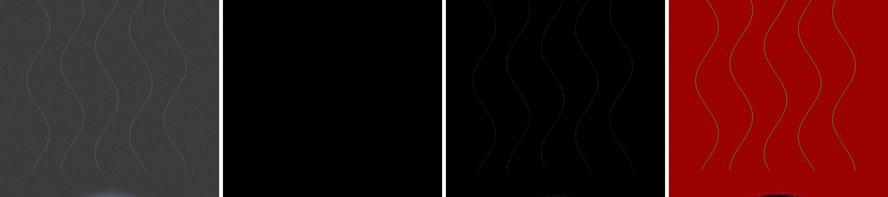

# OLED Auto Black for ComfyUI

Turns the "almost black" background that diffusion models leave behind into true `#000000`, automatically, per image. Made for OLED phone wallpapers, where a pixel at 0 is switched off and a pixel at 15 glows a visible grey in the dark.

It also protects what a plain threshold destroys: faint smoke wisps, hair, rim light and anti-aliased edges.


*Brightened 4× so the near-blacks are visible: input · plain threshold · OLED Auto Black · debug view*

## What it does

1. **Finds the haze.** Reads the histogram of the dark pixels, locates the background peak, and measures its noise (median absolute deviation).
2. **Sets the black point for you.** `black_point = haze + k·σ`, where the preset picks `k` (gentle 2, balanced 3, aggressive 5).
3. **Tells detail from noise.** Local standard deviation in a small window: flat haze only varies by σ, real detail varies far more.
4. **Two tone curves.** Flat haze fades smoothly to zero. Detected detail gets a linear stretch instead, so it keeps its contrast against the new black.
5. **Despeckles.** Removes isolated 1–2 px dots, keeps thin lines and genuinely bright stars.
6. **Keeps colour.** Darkness is judged by `max(R,G,B)` and applied as one gain per pixel, so hue never shifts and deep reds/blues survive.
7. **Dithers the fade** so soft glows don't band when saved as 8-bit.

An animated walkthrough of the maths is in [`docs/explainer.html`](docs/explainer.html).

## Install

**ComfyUI-Manager:** search for **OLED Auto Black** and install.

**Comfy CLI:**
```bash
comfy node install comfyui-oled-auto-black
```

**Manual:**
```bash
cd ComfyUI/custom_nodes
git clone https://github.com/YOUR_GITHUB_USERNAME/ComfyUI-OLED-Auto-Black
```

Restart ComfyUI. The node is under **image → postprocessing → OLED Auto Black**. An example workflow is in `example_workflows/`.

No extra dependencies beyond what ComfyUI already ships (numpy, torch).

## Inputs

| Input | Default | What it does |
|---|---|---|
| `enabled` | on | Pass-through when off. |
| `mode` | auto | `auto` measures each image. `manual` uses the two manual values below. |
| `preset` | balanced | How far above the detected haze the black point sits: gentle / balanced / aggressive. |
| `detail_protection` | 1.0 | Strength of the detail-vs-noise protection. 0 turns it off. |
| `shadow_dehaze` | 0.5 | Removes the grey veil from the subject's shadows. Fades out by mid-grey. |
| `despeckle` | on | Removes isolated noise dots in black areas. |
| `dither` | on | Prevents banding in the fade-to-black. Turn off if an upscaler follows, on for the final save. |
| `protect_color` | on | Uses `max(R,G,B)` instead of luminance, so deep saturated colours are kept. |
| `max_black_point` | 40 | Safety cap for auto mode (0–255 scale). |
| `manual_black_point`, `manual_range` | 8, 10 | Used only in manual mode. |

## Outputs

| Output | Type | |
|---|---|---|
| `image` | IMAGE | The processed image. |
| `black_mask` | MASK | 1 where the pixel is now exactly zero. |
| `debug_view` | IMAGE | Red = crushed, green = detail protected, blue = speck removed. |
| `report` | STRING | e.g. `haze≈15.5 σ≈2.1 → black_point=22 … pure black 87.2%` |
| `black_point` | INT | The black point chosen (median across a batch). |

## Tips

- Run it again after an upscaler: upscalers can lift blacks and add ringing.
- Prompts work best when they describe the black space explicitly ("pure black void background, extreme negative space").
- If wisps disappear, use `gentle`. If the sky isn't black enough on a noisy render, use `aggressive`; detail protection still applies.
- Images that aren't mostly dark are detected and left nearly untouched.

## License

MIT
